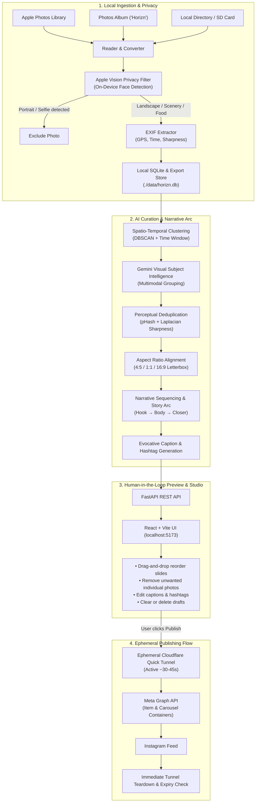

# Horizn 🌅

> **A 100% locally-hosted macOS service that turns your Apple Photos or camera folders into curated, story-driven Instagram carousels — powered by on-device privacy filtering, Gemini visual intelligence, and zero-cloud-cost ephemeral publishing.**

[](https://www.apple.com/macos/)
[](https://www.python.org/)
[](https://react.dev/)
[](https://fastapi.tiangolo.com/)
[](LICENSE)

---

## Key Highlights

- 🏔️ **Flexible Ingestion** — Scan your full **Apple Photos library**, target a specific **Photos album** (e.g. `Horizn`), or drop in any **local Mac folder / camera SD dump**.
- 🔒 **100% On-Device Privacy Filter** — Uses Apple's native Vision framework (`VNDetectFaceRectanglesRequest`) directly on Apple Silicon / macOS to exclude selfies, portraits, and people-focused photos before any network call.
- 🧠 **AI Visual Subject Clustering** — Combines spatio-temporal clustering (DBSCAN GPS + time window) with **Google Gemini Flash** multimodal reasoning. Photos are grouped by visual themes, moods, and subjects (e.g. sunsets, riverboats, night rituals) into natural, organic carousels.
- 🔄 **Narrative Sequencing** — Orders carousel slides using narrative storytelling principles:
  - **Slide 0 (Hook):** The single most striking, attention-grabbing visual.
  - **Slides 1…N-2 (Body):** Cohesive progression developing the visual journey.
  - **Slide N-1 (Closer):** A satisfying, contemplative final frame.
- ✍️ **Evocative Captions & Hashtags** — Automatically drafts 2–4 sentence travel captions grounded in visual details and geolocation, accompanied by 15 curated hashtags.
- 🎨 **Human-in-the-Loop Web Studio** — A sleek React + Vite dark-mode dashboard featuring an interactive Instagram phone mockup, drag-and-drop slide reordering (`@dnd-kit`), single-click slide deletion, and draft management.
- ⚡ **Zero-Cloud-Cost Ephemeral Publishing** — Publishes directly to Instagram via the Meta Graph API using an on-demand `cloudflared` Quick Tunnel. The tunnel opens strictly for ~30–45 seconds during Meta asset fetching and tears down immediately afterward. No permanent cloud storage or paid server hosting required.

---

## Architecture & Flow



---

## Ingestion Sources (Choose One)

Configure your source in `.env`:

```bash
# -------------------------------------------------------------
# Option A: Full Apple Photos Library
# Scans your entire Mac Photos library across a time window.
# -------------------------------------------------------------
PHOTOS_LIBRARY_PATH=~/Pictures/Photos Library.photoslibrary
INGEST_BATCH_MONTHS=12

# -------------------------------------------------------------
# Option B (Recommended): Dedicated Apple Photos Album
# Create an album in Apple Photos named "Horizn" and add photos.
# Only photos in this album are ingested.
# -------------------------------------------------------------
PHOTOS_ALBUM_NAME=Horizn

# -------------------------------------------------------------
# Option C: Local Mac Folder / Camera SD Dump
# Point directly to any folder on your Mac or external drive.
# Completely bypasses Apple Photos.
# -------------------------------------------------------------
LOCAL_PHOTOS_DIR=/Users/username/Pictures/MyVacation
```

---

## Quick Start

### 1. Prerequisites
- **macOS:** 13 Ventura, Sonoma, or Sequoia
- **Python:** 3.11 (`brew install python@3.11`)
- **Node.js:** 18+ LTS (`brew install node`)
- **cloudflared:** (`brew install cloudflared`)

### 2. Setup
Clone the repository and run the automated setup script:
```bash
git clone https://github.com/your-username/horizn.git
cd horizn
./scripts/setup.sh
```

### 3. Configure `.env`
Copy `.env.example` and add your keys:
```bash
cp .env.example .env
```
- **Gemini API:** Free key from [Google AI Studio](https://aistudio.google.com/) (`gemini-3.1-flash-lite`).
- **Instagram Graph API:** Add your Meta Developer credentials (see [Instagram Setup Guide](docs/instagram_setup.md)).

### 4. Run Horizn
```bash
./scripts/start.sh
```

Open your browser to:
- **Studio UI:** [http://localhost:5173](http://localhost:5173)
- **FastAPI Documentation:** [http://127.0.0.1:8000/docs](http://127.0.0.1:8000/docs)

> 📖 **Full Setup Documentation:** Check out the complete [Setup Guide](docs/setup.md) for in-depth guidance and troubleshooting.

---

## User Workflow

1. **Sync Photos:** Click **"Sync Photos"** in the top bar. Horizn scans your chosen source (album, library, or local folder), runs the on-device privacy filter, and extracts metadata.
2. **Run AI Curation:** Click **"Run AI Curation"**. The system clusters photos by GPS, time, and Gemini visual subject intelligence, builds the story narrative, and drafts captions.
3. **Review & Refine:**
   - In the **Queue**, inspect generated carousels and their visual themes.
   - Click any carousel to open the **Editor**.
   - Use the interactive phone preview or draggable slide list to reorder slides.
   - Click **"🗑️ Remove Slide"** or **"✕ Remove"** to drop any specific photo from the group.
   - Edit the caption or hashtags to your taste.
4. **Publish to Instagram:** Click **"Publish to Instagram"**. Horizn launches an ephemeral tunnel, feeds the media containers to Meta Graph API, verifies publication on your Instagram profile, and destroys the tunnel immediately.

---

## Project Structure

```
horizn/
├── horizn/
│   ├── config.py           # Pydantic BaseSettings & .env configuration
│   ├── database.py         # Async SQLite connection & schema management
│   ├── ingestion/          # Source reading, privacy filter, EXIF, conversion
│   │   ├── reader.py       # Reads Photos library, albums, or local folders
│   │   ├── privacy_filter.py # Apple Vision face & human detection
│   │   ├── exif_extractor.py # GPS, timestamp, aspect ratio, Laplacian sharpness
│   │   └── converter.py    # High-quality sRGB JPEG conversion
│   ├── curation/           # AI & algorithmic carousel curation
│   │   ├── clusterer.py    # DBSCAN GPS + time window + Gemini visual clustering
│   │   ├── deduplicator.py # Perceptual hash (pHash) near-duplicate suppression
│   │   ├── aspect_ratio.py # Dominant aspect ratio detection & letterboxing
│   │   ├── sequencer.py    # Gemini narrative flow (Hook → Body → Closer)
│   │   └── caption_gen.py  # Visual caption & hashtag drafting
│   ├── publisher/          # Zero-cloud-cost Instagram publishing
│   │   ├── tunnel.py       # Ephemeral cloudflared Quick Tunnel context manager
│   │   ├── instagram.py    # Meta Graph API v21.0 container flow
│   │   └── token_refresh.py# 60-day token refresh scheduler
│   └── api/                # FastAPI application & endpoints
│       ├── main.py         # App factory, CORS, static file mounts
│       └── routes/         # Ingest, carousels, publish, and stats routes
├── ui/                     # React 18 + Vite + TypeScript frontend
│   ├── src/
│   │   ├── pages/          # Queue and Editor pages
│   │   ├── components/     # CarouselMockup, SlideCard, PublishButton
│   │   └── api.ts          # Backend API client & SSE consumer
├── scripts/                # setup.sh, start.sh, refresh_token.sh
├── docs/                   # Setup and integration guides
│   ├── setup.md            # Detailed installation walkthrough
│   ├── instagram_setup.md  # Meta Developer & Instagram API instructions
│   └── cloudflared_setup.md# Quick tunnel details
├── data/                   # Local SQLite DB & converted JPEGs (git-ignored)
├── pyproject.toml          # Python package specification
└── README.md
```

---

## Detailed Guides

- [Step-by-Step Setup Guide](docs/setup.md)
- [Instagram Account & Meta Graph API Setup](docs/instagram_setup.md)
- [Cloudflare Quick Tunnel Integration](docs/cloudflared_setup.md)

---

## License

MIT License © 2026 Horizn Contributors. Built with privacy and simplicity for photographers and creators.
